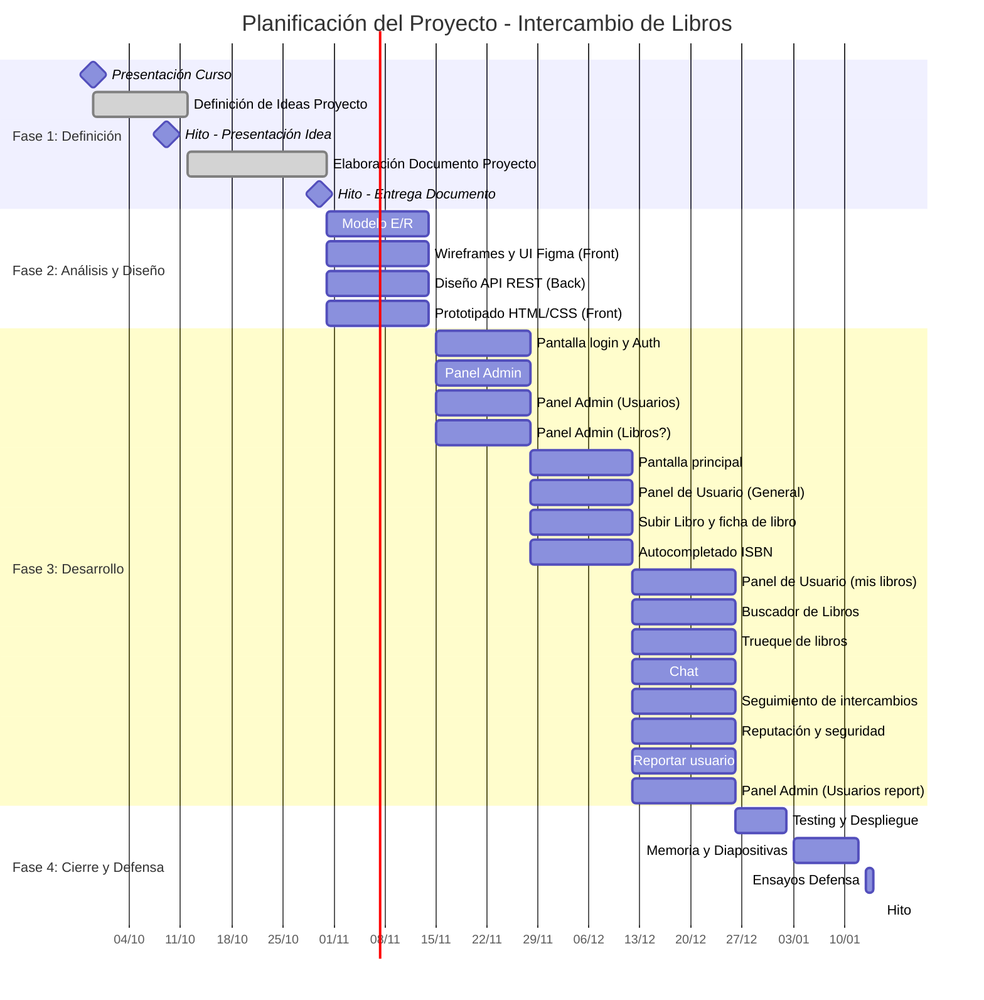

# LibroLibre

Aplicación web para intercambiar y donar libros entre vecinos. Proyecto final del ciclo DAW.

- **Front end:** Angular (`frontend/`)
- **Back end:** Laravel API REST (`backend/`)
- **Base de datos:** MySQL
- **Documentación:** `docs/`


## Diagrama Gantt Proyecto




## Estructura

```
librolibre/
├── backend/          Laravel (API REST)
├── frontend/         Angular
├── docs/             Diagramas, análisis, contrato de la API
└── .github/          Plantillas de PR y GitHub Actions
```

## Puesta en marcha (local)

### Back end

```bash
cd backend
cp .env.example .env
composer install
php artisan key:generate
php artisan migrate --seed
php artisan serve          # http://localhost:8000
```

Con Docker (Laravel Sail): `./vendor/bin/sail up -d` en lugar de `php artisan serve`.

### Front end

```bash
cd frontend
npm install
npx ng serve               # http://localhost:4200
```

## Flujo de trabajo con Git

- `main`: solo código estable (entregas).
- `develop`: rama de integración; las funcionalidades terminadas se fusionan aquí.
- Una rama por tarjeta de Trello, creada desde `develop`:
  - `feature/<descripcion-corta>` — funcionalidad nueva
  - `fix/<descripcion-corta>` — corrección de errores
  - `docs/<descripcion-corta>` — documentación
- Todo cambio entra por **pull request** a `develop`, con al menos **una revisión** y los tests en verde.

```bash
git checkout develop
git pull
git checkout -b feature/busqueda-por-isbn
# ... trabajar, hacer commits ...
git push -u origin feature/busqueda-por-isbn
# abrir el pull request en GitHub hacia develop
```

### Mensajes de commit

Formato corto en presente, con prefijo:

- `feat: añade búsqueda por ISBN`
- `fix: corrige filtro de distancia`
- `docs: actualiza diagrama ER`
- `test: añade tests del flujo de trueque`

## Importante

Nunca subas el archivo `.env`: contiene contraseñas y claves. Usa `.env.example` con valores ficticios.
